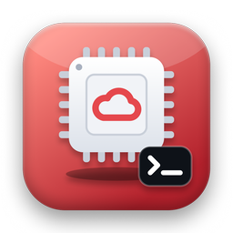

<p align="center"></p>

# oci-arm-catcher

[](https://github.com/deeplabua/oci-arm-catcher/actions/workflows/ci.yml)
[](https://crates.io/crates/oci-arm-catcher)
[](LICENSE)
[](https://github.com/deeplabua/oci-arm-catcher/stargazers)

**Grab Oracle Cloud's free ARM capacity the moment it appears.** A single,
dependency-free binary that retries `LaunchInstance` for the Always Free
`VM.Standard.A1.Flex` shape until Oracle finally has capacity — then launches
your instance and pings you.

Part of [DeepLab](https://deeplab.tools/products/oci-arm-catcher/) — small, sharp tools that run
locally.


<sub>Recorded against a local mock of the OCI API (`assets/demo/`) with a 5-second interval; the real default is 5 minutes.</sub>

If you've ever tried to create a free Ampere A1 instance and hit this,
repeatedly, for days:

```
ServiceError:
  code: InternalError
  message: Out of host capacity.
```

…this is for you. Start it, walk away, get a notification when your instance is
up.

> Works on **macOS, Linux, and Windows**. One binary that talks to the OCI API
> directly. Looking for the original bash / PowerShell scripts? They're in
> [`legacy/`](legacy/).

---

## Why this exists

Oracle's [Always Free tier](https://docs.oracle.com/en-us/iaas/Content/FreeTier/freetier_topic-Always_Free_Resources.htm)
gives every account **2 ARM OCPUs and 12 GB of RAM** on the Ampere A1 platform —
genuinely free, forever, no trial clock. Still one of the best free compute deals
anywhere: enough for a self-hosted app stack, a game server, or a personal VPN.

> **Note (June 2026):** Oracle quietly halved the Always Free Ampere allowance
> from 4 OCPU / 24 GB to **2 OCPU / 12 GB** (1,500 OCPU-hours + 9,000 GB-hours per
> month) on 15 June 2026, with no announcement. Pay-as-you-go accounts have
> reportedly kept the old 4 OCPU / 24 GB at no charge, but Oracle hasn't confirmed
> that publicly — check your own billing before assuming. Set `OCPUS` /
> `MEMORY_GB` in your `.env` to whatever your account actually allows.

The catch: those ARM hosts are in heavy demand, so launching an instance very
often fails with **"Out of host capacity"**. US regions can be dry for hours or
days; even busy EU/APAC regions dip in and out. Capacity frees up
unpredictably, in small windows, and whoever's polling at that second wins.

`oci-arm-catcher` is that poller. It hammers the launch API on a polite interval,
recognises the "no capacity, try again" family of errors, and grabs the slot the
instant one opens — including rotating across multiple Availability Domains if
your region has them.

It's a single binary with no runtime dependencies — it signs OCI API requests
itself with the key in your `~/.oci/config`, so there's no OCI CLI or Python to
install. The original scripts have caught a 4 OCPU / 24 GB A1 instance on a
real account (under the pre-June-2026 limits).

## Who it's for

Anyone trying to provision an Always Free (or paid) `A1.Flex` ARM instance who
keeps hitting capacity errors — homelabbers, self-hosters, indie devs, students,
and devops folks who want a free always-on ARM box.

---

## How it works

```
loop:
  LaunchInstance  shape=VM.Standard.A1.Flex ...
  ├─ success              → print instance OCID + console link, notify, exit 0
  ├─ 4xx (request is bad) → print it, notify, stop (so you can fix config)
  │   auth failure / bad OCID / LimitExceeded
  └─ everything else      → wait RETRY_INTERVAL, rotate AD, retry
      "Out of host capacity" / 429 TooManyRequests / 5xx / timeout / network blip
```

The error handling is the important part: it stops immediately on real problems
(bad OCID, auth failure, quota exceeded) instead of looping forever against a
wall, and keeps retrying on everything else, so an unfamiliar transient error
can't silently end a multi-day hunt.

After a network error the binary resends the *same* request with the same
`opc-retry-token`, so if the launch actually went through and only the answer
was lost, OCI hands back that instance instead of creating a second one.

---

## Install

One self-contained binary for macOS, Linux and Windows. It talks to the OCI API
directly — **no OCI CLI and no Python needed**. Pick one:

**macOS / Linux — Homebrew**

```bash
brew install deeplabua/tap/oci-arm-catcher
```

**macOS / Linux — installer script**

```bash
curl --proto '=https' --tlsv1.2 -LsSf https://github.com/deeplabua/oci-arm-catcher/releases/latest/download/oci-arm-catcher-installer.sh | sh
```

**Windows — PowerShell**

```powershell
powershell -c "irm https://github.com/deeplabua/oci-arm-catcher/releases/latest/download/oci-arm-catcher-installer.ps1 | iex"
```

**Any platform — from source** (needs [Rust](https://rustup.rs))

```bash
cargo install oci-arm-catcher
```

Or download an archive for your platform from
[Releases](https://github.com/deeplabua/oci-arm-catcher/releases).

**Updating.** Run the same install command again, or
`brew upgrade deeplabua/tap/oci-arm-catcher`. You don't have to watch for
releases: at most once a day the binary asks GitHub for the latest version and,
if there is a newer one, prints a short notice (on stderr, so
`discover > .env` stays clean). It's off in CI and when stderr isn't a
terminal; set `OCI_ARM_CATCHER_NO_UPDATE_CHECK=1` to turn it off entirely.

## Prerequisites

1. **An Oracle Cloud account** (Always Free is fine). Note your **home region**
   — the one picked at sign-up. Always Free instances can **only** be created
   there.
2. **A VCN with a public subnet** in your home region. The OCI console's "Create
   VCN with Internet Connectivity" wizard sets this up in one click.
3. **An API key in `~/.oci/config`.** In the console: profile menu → *My
   profile* → *API keys* → *Add API key* → *Generate API key pair*. Download
   the private key, then paste the "Configuration file preview" it shows into
   `~/.oci/config` and point `key_file` at the downloaded key. (If you already
   ran `oci setup config`, you're done.) `region` there must be your home
   region.

Check it works — this is read-only, and it warns if `region` isn't your home
region:

```bash
oci-arm-catcher check
```

---

## Quick start


```bash
oci-arm-catcher discover > .env   # read-only: prints your OCIDs as .env lines
# review .env (pick a subnet if you have several), then:
oci-arm-catcher
```

That's it. It retries until capacity appears, launches the instance, prints its
console link and sends a desktop notification. `oci-arm-catcher --help` lists
every flag; each one can also be set in `.env` or as an environment variable.

Prefer the original bash / PowerShell scripts (OCI CLI + Python)? See
[`legacy/README.md`](legacy/README.md).

---

## Configuration

All settings live in `.env` (see [`.env.example`](.env.example)), or can be
passed as flags. Precedence: flag > environment variable > `.env`.

### Auto-discover your OCIDs

```bash
oci-arm-catcher discover
```

It's **read-only** — it launches nothing, just prints your compartment,
availability domain(s), public subnets and the latest ARM image, formatted as
`.env` lines. Use `--os "Oracle Linux"` for a different image.

### Finding values manually

If you'd rather look them up in the console: **compartment** — the tenancy OCID
(profile menu → *Tenancy*); **availability domain** — *Compute → Instances →
Create instance → Placement*; **subnet** — *Networking → Virtual cloud networks
→ your VCN → Subnets*; **image** — an **aarch64** image from *Compute → Custom
images / Platform images*; **SSH key** — your `~/.ssh/*.pub`.

### All settings

Each setting can be a flag (`--retry-interval 120`), an environment variable or
a line in `.env`.

| Variable | Required | Default | Notes |
|---|---|---|---|
| `COMPARTMENT_ID` | yes | — | Compartment / tenancy OCID |
| `AVAILABILITY_DOMAIN` | yes\* | — | Single AD |
| `AVAILABILITY_DOMAINS` | yes\* | — | Comma-separated ADs to **rotate** across; overrides the single one |
| `SUBNET_ID` | yes | — | Public subnet OCID |
| `IMAGE_ID` | yes | — | ARM image OCID |
| `SSH_KEY_FILE` | yes | — | Path to your `.pub` key |
| `OCPUS` | yes | — | Always Free max is 2 total (was 4 before 15 Jun 2026) |
| `MEMORY_GB` | yes | — | Always Free max is 12 total (was 24 before 15 Jun 2026) |
| `DISPLAY_NAME` | no | `arm-free-1` | Instance name in the console |
| `RETRY_INTERVAL` | no | `300` | Seconds between attempts |
| `BOOT_VOLUME_GB` | no | 50 (Oracle's default) | Boot volume size; the 200 GB Always Free block storage is shared by all boot and block volumes |
| `MAX_ATTEMPTS` | no | unlimited | Give up after this many attempts |

Credentials come from `~/.oci/config` (`--oci-config`, `--profile` to change).

\* Set **either** `AVAILABILITY_DOMAIN` (one AD) **or** `AVAILABILITY_DOMAINS`
(rotation). If both are set, the rotating list wins.

### Multi-AD rotation

Regions like Ashburn, Phoenix, and Frankfurt have three Availability Domains,
and capacity can appear in any one of them. Set them all and the catcher cycles
through on each retry, multiplying your chances:

```bash
AVAILABILITY_DOMAINS="Abcd:US-ASHBURN-1-AD-1,Abcd:US-ASHBURN-1-AD-2,Abcd:US-ASHBURN-1-AD-3"
```

(Most single-AD regions just use `AVAILABILITY_DOMAIN`.)

---

## Keeping your instance

Oracle [may reclaim](https://docs.oracle.com/en-us/iaas/Content/FreeTier/freetier_topic-Always_Free_Resources.htm)
an Always Free instance it considers idle: over 7 days, CPU (95th percentile),
network **and** memory utilisation all below 20%. After a long hunt, put the
server to real use — a sleeping instance can be taken back.

The full Always Free compute allowance, for reference: **A1.Flex — 2 OCPU and
12 GB in total** (one instance, or two smaller ones), plus up to two
**E2.1.Micro** (1/8 OCPU, 1 GB) instances, and **200 GB** of block storage
shared by all boot and block volumes. All in your home region.

---

## Running it in the background

You'll likely want this running for hours. Pick one:

**tmux / screen** — a session you can detach from and come back to:

```bash
tmux new -s catcher
oci-arm-catcher
# detach: Ctrl-b then d   ·   reattach: tmux attach -t catcher
```

**nohup** — fire and forget, logs to a file:

```bash
nohup oci-arm-catcher > catcher.log 2>&1 &
tail -f catcher.log
```

**Windows** — leave a PowerShell window open, or start it in the background:

```powershell
Start-Process oci-arm-catcher -RedirectStandardOutput catcher.log -WindowStyle Hidden
```

In a terminal you get a live countdown; in a log file, one line per attempt.

---

## Troubleshooting

**`oci-arm-catcher check` fails with `NotAuthenticated` (401)**
The key or fingerprint in `~/.oci/config` doesn't match the API key uploaded in
the console, or `key_file` points at the wrong file. OCI also answers 401 when
`region` is one your tenancy isn't subscribed to — set it to your home region. Encrypted keys aren't
supported yet — write an unencrypted copy with
`openssl rsa -in key.pem -out key_nopass.pem` and point `key_file` at it.

**It keeps printing `InternalError: Out of host capacity.`**
That's expected — it's working. Capacity genuinely isn't available yet. Leave it
running. Consider adding more Availability Domains.

**`NotAuthorizedOrNotFound` and it stops immediately**
This is *not* a capacity error, so the catcher stops on purpose. Usually a wrong
or mismatched OCID — check that `COMPARTMENT_ID`, `SUBNET_ID` and `IMAGE_ID`
all belong to the **same region** as your profile.

**`LimitExceeded`**
You've hit your Always Free allowance — **2 OCPU / 12 GB total** since 15 June
2026 (it was 4 OCPU / 24 GB before). Delete or shrink existing A1 instances, or
lower `OCPUS` / `MEMORY_GB`. Not a capacity error, so the catcher stops.

**The image won't boot / wrong architecture**
`IMAGE_ID` must be an **aarch64 / ARM** image; x86 images won't launch on
`A1.Flex`. `discover` only lists ARM images.

**Notifications don't show up**
They're best-effort; the terminal output is always there. On Linux they need a
running notification daemon (any desktop environment has one).

---

## Development & tests

The Rust workspace has two crates: `crates/core` (`oci-arm-catcher-core` — config,
request signing, API client and the retry loop) and `crates/cli` (the
`oci-arm-catcher` binary).

```bash
cargo test
cargo clippy --workspace --all-targets -- -D warnings
cargo fmt --all
cargo run -- check          # read-only call against your own account
```

The README GIFs are recorded with [VHS](https://github.com/charmbracelet/vhs)
against a local mock of the OCI API: `vhs assets/demo/demo.tape`. Tests for the
legacy scripts are described in [`legacy/README.md`](legacy/README.md#tests).

---

## Disclaimer

This tool only calls the official OCI API with your own key, on a polite retry
interval — it doesn't bypass any limits or do anything Oracle's own console
doesn't. You're responsible for staying within your account's terms and free-tier
limits. Provided as-is under the MIT License.

## Contributing

Issues and PRs welcome — especially: more OS/notification backends, smarter
backoff, and region/AD presets.

## Support

If `oci-arm-catcher` caught you a free server, two things help a lot:

- ⭐ **[Star the repo](https://github.com/deeplabua/oci-arm-catcher)** — it's how other people fighting "Out of host capacity" find it.
- ☕ **[Buy me a coffee](https://send.monobank.ua/jar/4Hq7auheaa)** — if it saved you some time and you feel like it.

Both are completely optional. The tool is free and always will be.

## License

[MIT](LICENSE)
